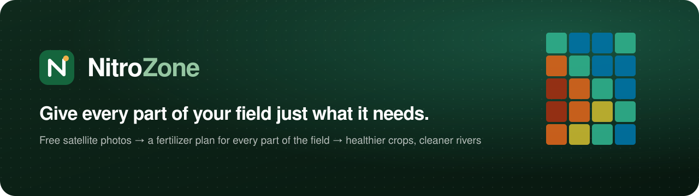
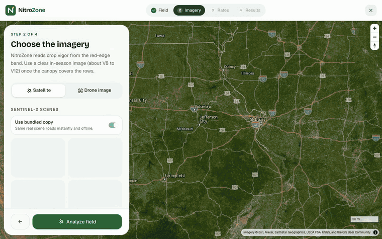
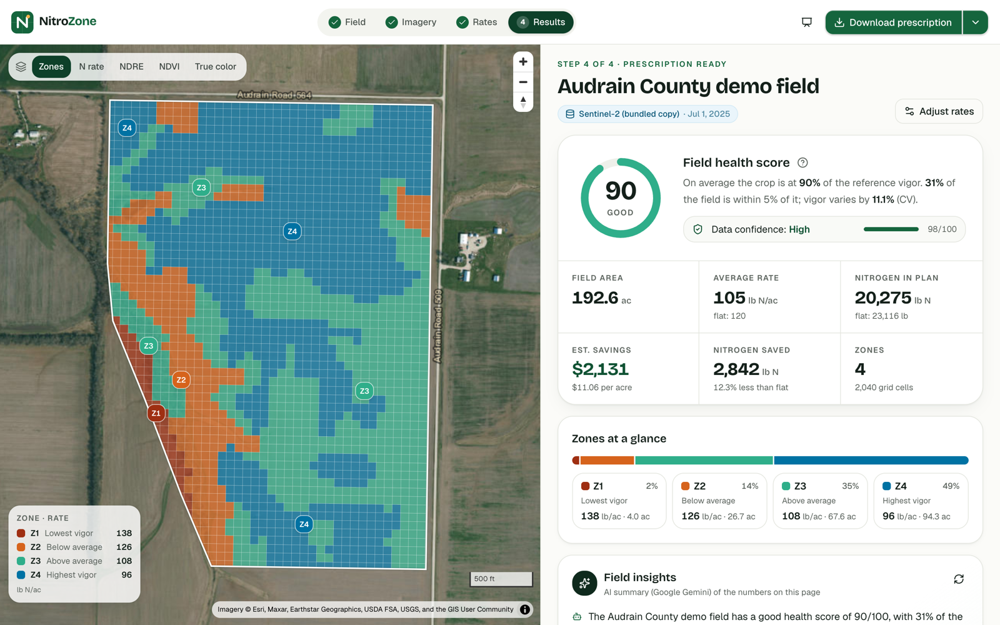
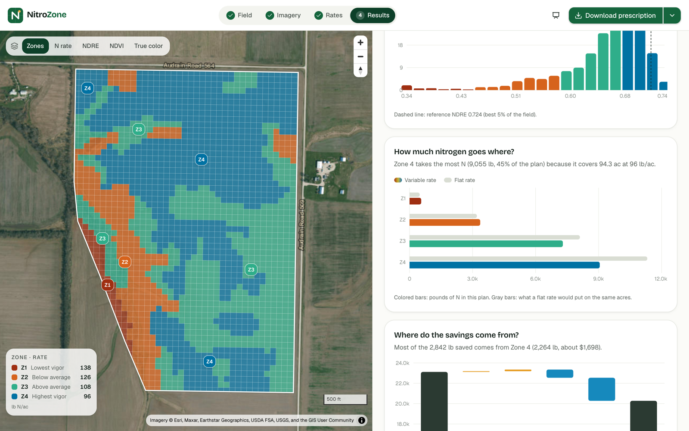
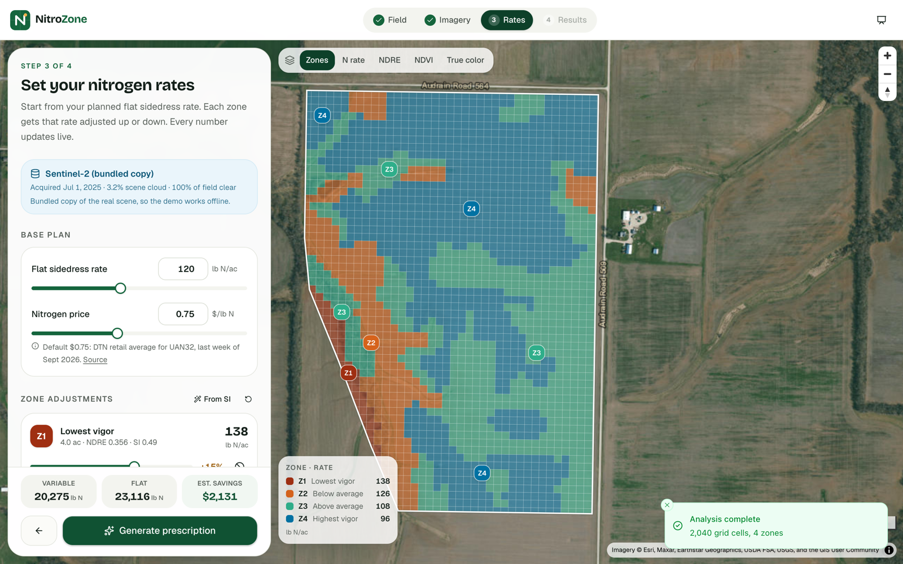
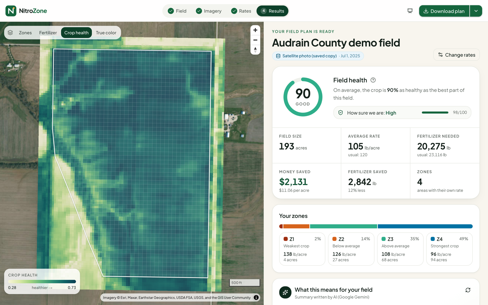
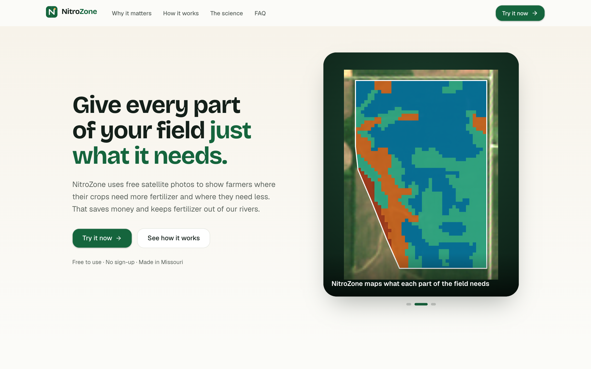
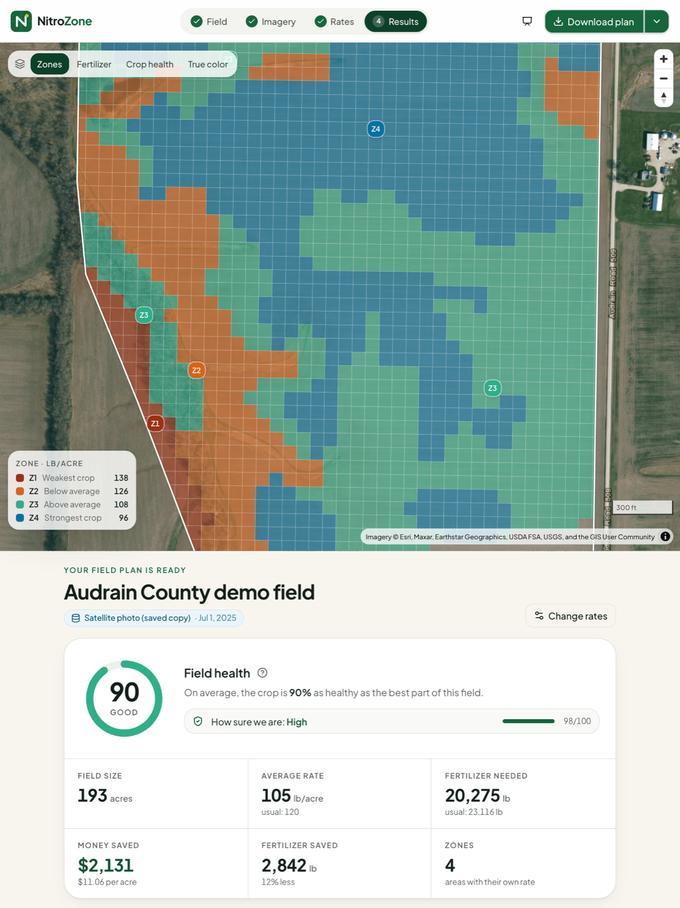
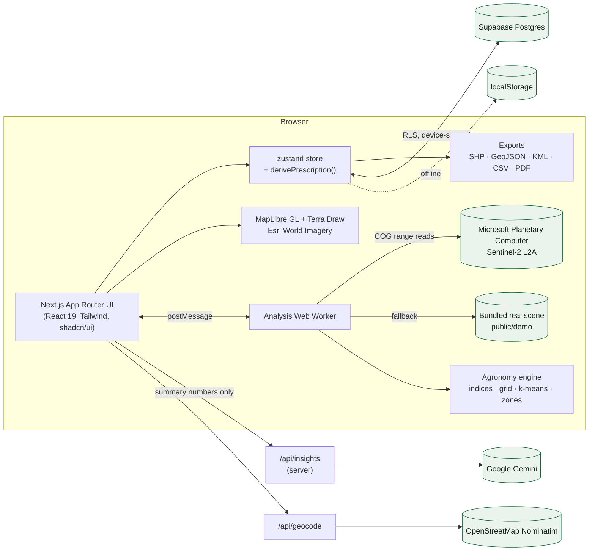

<p align="center">
  
</p>

<p align="center">
  
  
  
  
  
  
  
</p>

<p align="center">
  <b><a href="#quick-start">Quick start</a> · <a href="#how-it-works">How it works</a> · <a href="#the-agronomy">The agronomy</a> · <a href="#architecture">Architecture</a> · <a href="#setup">Setup</a> · <a href="#limitations">Limitations</a></b>
</p>

> [!NOTE]
> NitroZone is a Congressional App Challenge project. It produces **estimated** prescriptions from vegetation indices, which are a stress proxy and not a direct nitrogen measurement. Always scout, and follow University of Missouri Extension guidance and your agronomist.

## Why NitroZone

Most Missouri corn gets one nitrogen rate from fence to fence, but no field is uniform. Strong areas get more N than the crop can use, and that surplus can leave the field. The USGS estimates that **66% of the nitrogen reaching the Gulf of Mexico** from the Mississippi basin comes from cultivated crops, mostly corn and soybeans ([source](https://water.usgs.gov/nawqa/sparrow/gulf_findings/primary_sources.html)). In University of Missouri on-farm demos, sensor-guided sidedressing **saved 24 lb N/acre on average while breaking even on yield** ([source](https://extension.missouri.edu/media/wysiwyg/Extensiondata/Pro/NutrientManagement/Docs/Crop_Sensors_to_Guide_N_Application_to_Reduce_N_Loss.pdf)). Those demos needed expensive canopy sensors.

**NitroZone helps any farmer do the same kind of analysis with free satellite photos, in a web browser.** It was built and tested on Missouri corn and fits crops that need in-season nitrogen, such as corn, wheat and sorghum. Draw your field, let it read Sentinel-2's red-edge band, review the zones it finds, and download a shapefile your rate controller can load.

<p align="center">
  
</p>

## Screenshots

| Results: zones revealed over satellite imagery | Charts that each answer one question |
|---|---|
|  |  |
| **Rates: every number updates live** | **NDRE heat map (10 m pixels)** |
|  |  |
| **Homepage** | **iPad layout** |
|  |  |

## Features

| | |
|---|---|
| **Live Sentinel-2 L2A** | Scene search, cloud % and field-cropped thumbnails; only the field's pixels are downloaded (COG range requests) in a Web Worker |
| **Honest cloud masking** | SCL classes 0/1/3/8/9/10/11 removed; gap-filled cells marked *estimated* everywhere |
| **NDRE-first zoning** | k-means (seeded, reproducible), 3×3 majority filter, small-zone merging for real machinery |
| **N-rich strip & SI** | Draw a reference strip, or use a virtual reference (95th percentile) |
| **Transparent rates & savings** | `rate = base × (1 + adj)`; `savings = (flat − plan) × price`, with a warning when the plan uses more N |
| **Review & edit zones** | Click-to-inspect any grid cell, keyboard navigation, brush painting, undo/redo |
| **Five interactive charts** | Vigor distribution (drill-down to the map), N by zone, savings waterfall, field profile, NDVI-vs-NDRE |
| **Field insights** | Gemini (server-side) explains the computed numbers; rule-based fallback always works |
| **One-click download** | Shapefile (RATE_LBAC/ZONE/AREA_AC, WGS84) + GeoJSON + KML + CSV + one-page PDF, validated by round-trip tests |
| **Save & share** | Supabase (RLS) with localStorage fallback; read-only report links |
| **Never dead-ends** | Live imagery → bundled real scene → labeled synthetic raster |
| **Presentation mode** | `/app?present=1` or press <kbd>P</kbd>: demo field, larger type, dev UI hidden |

## Quick start

```bash
npm install
npm run dev        # http://localhost:3000
```

Open **http://localhost:3000/app?demo=1**, press **Analyze field**, then **Generate prescription**. No keys are needed: without Supabase the app saves to your browser, and without Gemini it uses rule-based insights.

## How it works

1. **Find & draw:** search an address (OpenStreetMap), click the field corners on Esri imagery, or import a boundary (shapefile ZIP, KML, GeoJSON).
2. **Analyze:** pick a Sentinel-2 scene (out of season, NitroZone shows the latest Jun 10–Jul 20 sidedress window). The worker downloads B4/B5/B8/SCL, masks clouds and computes NDRE/NDVI.
3. **Zone & rate:** the grid is clustered into 3–5 zones; you set the base rate, N price and per-zone adjustments.
4. **Results & export:** zones sweep in over the map, with the summary, charts, editing and downloads.

## Architecture



## The agronomy

| Formula | Meaning |
|---|---|
| `NDRE = (B8 − B5) / (B8 + B5)` | Red-edge index: primary nitrogen-stress signal, stays sensitive after canopy closure |
| `NDVI = (B8 − B4) / (B8 + B4)` | General greenness (secondary feature; saturates in dense corn) |
| `VARI = (G − R)/(G + R − B)`, `ExG = 2g − r − b` | Drone RGB indices (greenness, less N-specific) |
| `zone rate = base × (1 + adjustment)` | Clamped to your applicator min/max |
| `savings = (flat lb − plan lb) × $/lb N` | Fertilizer-cost estimate only |
| `SI = zone NDRE ÷ reference NDRE` | Reference = N-rich strip, or the field's 95th percentile |
| `health = 100 × mean(min(SI, 1))` | Area-weighted relative vigor (not a nitrogen test) |

Defaults: 120 lb N/ac base, adjustments +15/+5/−10/−20% for 4 zones (more N where the crop is paler), $0.75/lb N (DTN UAN32, late Sept 2026). Everything is editable. The full methodology is at `/science`, and every statistic is sourced in [SOURCES.md](SOURCES.md).

## Tech stack

**Next.js 16** (App Router, Cache Components) · **TypeScript strict** · **Tailwind CSS 4** · **shadcn/ui** (Radix) · **motion** · **lucide** · **MapLibre GL 6** + **Terra Draw** · **geotiff.js** · **proj4** · **Turf** · **Recharts 3** · **zustand** · **TanStack Query** · **zod** · **jsPDF** · **@mapbox/shp-write** / **shapefile** · **JSZip** · **Supabase** · **Gemini API** · **Vitest** · **Playwright**

## Setup

### Environment variables

Copy `.env.example` to `.env.local`. All variables are optional.

| Variable | Exposed to browser? | Purpose |
|---|---|---|
| `NEXT_PUBLIC_SUPABASE_URL` | yes | Supabase project URL |
| `NEXT_PUBLIC_SUPABASE_PUBLISHABLE_KEY` | yes (publishable/anon key only) | Saved fields, prescriptions, share links, run analytics |
| `GEMINI_API_KEY` | **no, server only** | Field insights |
| `GEMINI_MODEL` | no | Defaults to `gemini-2.5-flash` (falls back to `gemini-flash-lite-latest`) |

### Database (Supabase)

Run [`SUPABASE_SETUP.sql`](SUPABASE_SETUP.sql) once in **Supabase Dashboard → SQL Editor** (it's idempotent), or `supabase db push` with the linked CLI. It creates `fields`, `prescriptions`, `shared_reports` and `analysis_runs`, all with **Row Level Security**:
- fields/prescriptions are visible only to the browser that created them (random device ID sent as `x-device-id` and checked in policies);
- shared reports can be created by anyone but only read by their unguessable slug (`get_shared_report()`), and can't be listed;
- analytics are insert-only.

### Commands

| Command | What it does |
|---|---|
| `npm run dev` | Dev server |
| `npm run build && npm start` | Production build |
| `npm run typecheck` / `npm run lint` | Types / ESLint |
| `npm test` | Unit + export round-trip tests (Vitest) |
| `npm run test:e2e` | Browser tests (Playwright; run `npx playwright install chromium --no-shell` once) |
| `node scripts/cache-demo-imagery.mjs` | Re-download the bundled demo scene |
| `npm run gen:hero` | Rebuild the landing-page hero data from the demo analysis (macOS `sips`) |

## Data sources

- **Copernicus Sentinel-2 L2A** (ESA), served by [Microsoft Planetary Computer](https://planetarycomputer.microsoft.com/dataset/sentinel-2-l2a). Contains modified Copernicus Sentinel data.
- **Esri World Imagery** basemap (© Esri, Maxar, Earthstar Geographics and partners).
- **USDA NASS Cropland Data Layer** to verify the demo field was corn (93.3% in 2025).
- **OpenStreetMap Nominatim** for address search.
- Research and statistics: see [SOURCES.md](SOURCES.md).

## Limitations

- Vegetation indices are a **stress proxy**. Low vigor may be water stress, compaction, disease or poor stand, where extra N won't pay, so scout low zones first.
- 10 m pixels miss problems smaller than a few metres; cloud masks can miss thin haze.
- Default rates and the "From SI" heuristic are starting points, not calibrated recommendations.
- Savings are fertilizer cost only; yield response isn't modeled.
- No login yet: saved data is tied to a browser, not an account.

## Roadmap

- [ ] Accounts (Supabase Auth) replacing device IDs
- [ ] Multi-date imagery comparison and time series
- [ ] Soil-survey (SSURGO) and yield-map layers to explain low-vigor zones
- [ ] University of Missouri sensor-based N rate algorithm option
- [ ] ISO-XML / vendor-specific controller exports
- [ ] Field-level crop check via the Cropland Data Layer API

## Project docs

[DECISIONS.md](DECISIONS.md) (why things are the way they are) · [DESIGN_NOTES.md](DESIGN_NOTES.md) (design research) · [CODE_WALKTHROUGH.md](CODE_WALKTHROUGH.md) (tour of the code) · [SOURCES.md](SOURCES.md) (every statistic)

---

<p align="center"><br/><sub>Built in Missouri for cleaner rivers and leaner fertilizer bills.</sub></p>
